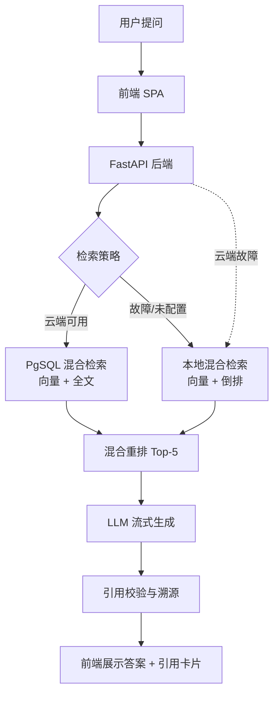

# Regulation\_Agent · 建筑规范智能助手

> 面向建筑师、工程师、审图人员、及项目业主的垂直规范 RAG 问答系统。
> 我的角色：产品经理，独立完成 0-1 mvp。
> 默认规范库：《建筑防火通用规范》GB 55037-2022，241 条结构化条款。

迭代记录：
   V1 完成基础的 RAG 问答系统，支持查询规范库中的条款。
   V2 增加断网时的本地回退功能，确保用户在无网络环境下也能使用。同时确保pgsql崩溃时仍能本地哈希兜底。


## 1、项目速览

- 我的角色：产品经理 / 独立 MVP 负责人
- 项目周期：4 周
- 团队：独立完成 + 2 位总监级测试用户
- 核心结果：核心链路跑通，2 位总监级用户验证了引用溯源和本地回退的价值；反馈集中在规范库覆盖和回答可读性。
- 技术关键词：RAG、余弦相似度匹配、混合检索、引用溯源、防幻觉、本地回退

## 二、为什么做这个项目（详见PRD）

我在建筑行业从业 8 年时间，做过乙方项目经理、主创设计师，也合伙做过设计工作室。查规范是建筑行业最核心最严肃的工作内容之一：

| 痛点    | 现状                        | 后果                |
| ----- | ------------------------- | ----------------- |
| 效率低   | 国标、地标、行标分散，靠 PDF 搜索或翻纸质书  | 打断设计思路，影响进度       |
| 容错低   | 图纸要报审，前期埋雷后期爆发            | 返工、经济损失、报批延迟      |
| 认知误差  | 条文晦涩，不同人理解不同              | 沟通成本高，容易埋雷        |
| 临时场景  | 会议、工地现场需要立刻核实规范，查规范的场景碎片化 | 无法现场立刻解决矛盾，影响专业形象 |
| AI 幻觉 | 通用AI大模型编造条文，有幻觉           | 无法可靠、规模化用于严肃业务    |
| 成本问题  | 整本规范传参查询Tokens消耗巨大、响应慢    | 无法可靠、规模化用于严肃业务    |

规范问题涉及从设计、审核、施工、验收、各专业配合等多个流程，一旦出错会造成人力成本、时间成本浪费，甚至是经济损失及生命安全。但现实中查规范是一件 **“麻烦事”**。

**项目的价值并非替代审图或注册建筑师，而是把“麻烦事”变为“简单事”，让“查规范”这个动作变得极致简单、可靠、可溯源。**

## 三、产品定位（详见PRD）

**定位：** 面向建筑行业的垂直规范 RAG 问答工具，答案只来自命中条文，引用可点击回溯原文。

**对外承诺：**
１）所有解读均标注出处来源，点击可回溯原文。
２）未命中时，明确告知“未找到”，不输出无依据内容。（用户可通过优化问题和提示词提升命中率）
３）云端异常时，本地local版本立马接管（不可感知），基础查询不中断保证最低可用性。\*\*

**不做：**

- 不替代审图、不出具合规结论
- 不提供法律意见
- 不覆盖全部地标（前期）
- 不做结构计算、不自动生图改图
- 不承诺 100% 准确

***

## 四、核心功能

### 1. 自然语言规范问答

- 输入自然语言问题，输出流式解读 + 引用卡片
- 支持流式（`/api/regulation/chat`）与非流式（`/api/regulation/query`）两种接口
- 可选“仅返回规范原文，不生成 AI 解读”（后续迭代此功能）

### 2. 条文精准溯源

- 引用卡片包含：规范名称 + 规范编号 + 章 + 节 + 条款号 + 原文 + 条文说明
- 引用卡片起兜底作用：若 LLM 没输出引用块但检索到了条款，条款仍会以引用卡片形式返回
- LLM输出的引用模块编号必须来自检索元数据，禁止模型生成编号
- 服务端校验：输出中的每个引用编号必须存在于当次检索结果中（出现幻觉就用正则抛弃，用户可通过引用溯源核实）

### 3. 混合检索

- 语义向量余弦相似度 + 全文关键词匹配
- 权重混合重排，取 Top-5 作为最终结果
- 支持精确编号命中与模糊语义查询

### 4. 防幻觉约束

- **Prompt 约束**：System Prompt 明确"必须严格基于给定条款作答，禁止编造未在条款中出现的规范要求"
- **引用校验**：LLM 输出的引用编号必须命中检索结果，否则丢弃
- **未命中降级**：检索无结果时返回"未找到"，不生成解读
- **免责提示**：所有答案附"请以规范原文及注册建筑师意见为准"

### 5. 本地回退

- 云端 LLM / Embedding API / PostgreSQL 不可达时，自动切换本地模式
- 本地模式：哈希向量 + 倒排索引全文检索 + 原文拼装回答（不提供 AI 解读）
- 接管时间目标 ≤1s，恢复后自动切回云端，保证体验无感

### 6. 规范库管理

- 支持 PDF / DOC 上传、解析、切片、入库、版本更新（DOCX 解压`word/document.xml`；PDF pypdf 兜底）
- 唯一键（每本规范），支持版本迭代
- 入库后跑回归评测，达标后生效
- 保留原件与含层级关系的元数据

***

## 五、设计决策

1. 为什么规范切片不重叠？
   建筑规范天然具备条款结构：章 -> 节 -> 条，单条长度通常不超过 500 字。
   因此切片按“条/款”粒度处理，保留：规范编号 -> 规范名称 -> 章节号 -> 条文号 -> 原文。
   不重叠切片可以避免检索结果重复，也便于引用卡片精准回溯。
2. 为什么用混合检索?
   纯语义检索：对例如“第 x.x.x 条” 或 “XXX通道宽度要求”这类精确编号或精确信息不敏感
   纯关键词检索：对“疏散距离不够怎么办，有啥要求”这类口语化问题不敏感
   混合检索：语义 + 关键词，兼顾模糊提问与精确编号（信息）
3. 本地回退怎么实现？
   预先构建哈希向量与全文索引（构建pgsql向量库的同步构建兜底本地库）
   云端 API 超时 / 数据库不可达时，自动切换本地模式
   本地模式只保证最低可用：关键词/编号精确命中 + 原文展示
   不提供 AI 解读，避免在不可靠环境下生成错误内容
4. 防幻觉怎么做的？
   Prompt 约束：只允许基于命中切片生成
   引用编号必须来自检索元数据
   服务端校验：引用编号不在当次检索结果中，直接拦截
   校验失败降级：返回“未找到可靠条文”
   所有答案附带免责提示

## 六、评测与反馈：20 条人工评测集验证

为了验证 RAG 系统的检索准确率和防幻觉能力，我构建了包含 **20 条典型 Query** 的人工评测集（涵盖精确编号、口语化描述、跨章节复合要求、规范外诱导提问四类场景），并以此作为系统回归测试的基线。

**评测结果概览：**
*   **检索召回与准确率**：100%（Top-5 均精准匹配预期条款）
*   **引用溯源有效性**：100%（回答中的引用均正确关联元数据原文）
*   **防幻觉拦截率**：100%（对于规范外问题，系统均正确执行拦截，回复“未找到”，未发生幻觉编造）

**典型评测案例展示：**

| 提问类型 | 用户提问 (Query) | 期望命中 | 系统表现 |
| :--- | :--- | :--- | :--- |
| **精确编号** | 第 2.2.3 条对消防救援口的净高度、净宽度有什么要求？ | 2.2.3 | 精准匹配 2.2.3，引用与结论正确 |
| **口语化** | 消防电梯前室的使用面积和短边最小要做到多少？ | 2.2.8 | 精准匹配 2.2.8，且自动引导至 7.1.8 条 |
| **跨章节** | 高层公共建筑里的儿童活动场所，楼层布置和安全出口分别有什么要求？ | 4.3.4 + 7.4.3 | 准确识别意图，成功跨章匹配两条规范 |
| **规范外(防幻觉)** | 消防电梯轿厢内按钮的颜色和尺寸有什么规定？ | 无 | 判定为规范外，正确回复“未找到”，未编造 |

> 📁 **相关附件：**
> *   [完整 20 条评测集数据 (`eval/test_cases.csv`)](eval/test_cases.csv)
> *   [完整 20 条评测结果 (`eval/test_report.csv`)](eval/test_report.csv)

## 七、我的贡献

主导需求分析、用户访谈、产品定位、PRD、技术选型；
设计核心方案：混合检索、引用溯源、本地回退、防幻觉四层约束；
独立完成 MVP 核心链路验证与实现，关键代码逐行审查审核；
设计评测标准指标；
组织 2 位设计总监/设计院负责人内测，收集 3 条反馈；
周边工程（前端、sql、及部分核心逻辑等）借助AI编程工具并逐行审核理解修改，核心逻辑手写实现。

## 八、路线图

-已完成
自然语言对话
引用溯源
引用卡片
本地回退
混合检索
防幻觉

-P1
项目数据库：历史对话与项目归档
反馈系统：赞/踩 + 错误 case 回流
多规范库切换：全行业 / 国标 / 地标 / 行标 / 规范编号

-P2
团队共享
审图清单导入 / 导出
集成到 CAD / BIM / 模型

## 九、技术架构



## 十、快速开始

### 配置

```bash
# 1. 克隆仓库
git clone https://github.com/[你的用户名]/regulation-agent.git
cd regulation-agent

# 2. 安装 uv（若未安装）
brew install uv            # macOS；其他平台见 https://docs.astral.sh/uv/

# 3. 同步依赖（uv 自动创建 .venv，并按 uv.lock 精确还原依赖）
uv sync

# 4. 配置环境变量（可选，不配则走本地哈希向量 + 离线拼装回答）
cp .env.example .env       # 填入你自己的 SILICONFLOW_API_KEY（可选：OPENROUTER_API_KEY）
```

### 方式一：本地离线模式（零依赖，开箱即用）

```bash
# 5. 修改 conf.yml：rag.backend = local

# 6. 启动应用
uv run python main.py
# 访问 http://localhost:8090

# 无 uv 时，可用传统 pip 方式替代步骤 2-3：
# python -m venv .venv && source .venv/bin/activate && pip install -e .
```

### 方式二：PostgreSQL + pgvector 模式（完整能力）

```bash
# 1. 启动 pgvector 容器
docker compose -f docker-compose.pgvector.yml up -d

# 2. 修改 conf.yml
#    rag.backend: pgsql
#    填写 postgresql / vector_store / llm 配置

# 3. 启动应用（首次启动会自动建表 + 解析规范 + 向量化入库）
#    若尚未执行过 uv sync，先运行一次
uv run python main.py
```

### 接口速览

| 接口                       | 方法   | 说明                                                                               |
| ------------------------ | ---- | -------------------------------------------------------------------------------- |
| `/api/regulation/health` | GET  | 健康检查，返回 200                                                                      |
| `/api/regulation/query`  | POST | 非流式问答，返回 `{answer, citations}`，可选参数 `k`（默认 5）                                    |
| `/api/regulation/chat`   | POST | 流式问答，协议：`refs:<json>` → `token` 流式（LLM 失败时逐行回退引用溯源）→ `end:<json>`，可选参数 `k`（默认 5） |

***

## 十一、目录结构

```
regulation-agent/
├── main.py                          # FastAPI 入口：lifespan 初始化索引 + 中间件 + 路由
├── conf.yml                         # 全局配置（规范、检索后端、向量、PG、LLM 模型池）
├── pyproject.toml                   # 依赖声明
├── docker-compose.pgvector.yml      # pgvector 一键部署
├── .env.example                     # 环境变量模板（复制为 .env 后填入 Key）
├── .gitignore                       # Git 忽略规则（排除 .env / .venv / data/18 等）
├── .python-version                  # Python 版本锁定（uv 使用）
├── uv.lock                          # uv 依赖锁定（精确还原环境）
├── dist/
│   ├── index.html                   # 前端 SPA（流式渲染 + 引用卡片）
│   └── book.svg
├── data/                            # 本地离线索引产物
│   ├── clauses.json                 # 结构化条款
│   ├── vectors.npy                  # 向量矩阵 (N, 1024)
│   ├── inverted_index.json          # 倒排索引 + IDF
│   ├── meta.json                    # 元信息
│   └── 18/docker/                   # Docker 运行时数据目录（PostgreSQL 数据卷，不提交）
├── eval/                            # 评测集数据与报告
│   ├── test_cases.csv               # 20 条人工评测集
│   └── test_report.csv              # 评测集数据目录
└── app/
    ├── api/regulation.py            # API 路由：/query /chat /health
    ├── core/
    │   ├── pdf_parser.py            # 规范解析：DOCX/PDF → Clause 列表（保留层级）
    │   ├── regulation_agent.py      # RAG 主流程：检索 → 生成 → 引用校验 → 流式输出
    │   ├── vector_store.py         # bge-m3 嵌入 + pgvector 写入与余弦检索
    │   ├── doc_store.py             # jieba 分词 + tsvector 全文检索
    │   ├── db_service.py            # PostgreSQL 连接池 + 建表 + 加载
    │   └── local_store.py           # 本地离线索引（哈希向量 + 倒排 + TF-IDF）
    ├── config/conf.py               # OmegaConf 配置加载 + 环境变量解析
    ├── dto/reg_model.py             # ORM 模型（regulation / regulation_clause）
    ├── prompt/regulation_rag.yml    # RAG Prompt 模板（Jinja2 渲染）
    ├── util/
    │   ├── ask_llm.py               # 异步 LLM 调用（超时控制 + 重试）
    │   ├── prompt.py                # Prompt 模板加载与渲染
    │   ├── parse.py                 # JSON 解析工具
    │   └── log.py                   # Loguru 日志配置
    └── middleware/trace_middleware.py  # 链路 trace_id 中间件
```

## 十二、技术栈

语言：Python 3.10+
依赖/环境管理 | uv（`uv.lock` 锁定，`uv sync` 还原环境，`uv run` 启动）
后端框架：FastAPI + Uvicorn(异步非阻塞)
前端：HTML/JS SPA(零依赖)(dist/index.html)
云端检索：PostgreSQL 18 + pgvector(向量) + tsvector(全文)
本地检索：numpy(哈希向量余弦相似度) + jieba(分词后倒排索引) -> TF-IDF
Embedding：BAAI/bge-m3(1024维，SiliconFlow API)
LLM：DeepSeek-V3.2 / GLM-4.6 / MiniMax-M2 / GPT-4o-mini(模型根据需求可切换)
ORM：SQLAlchemy 2.0 异步 + asyncpg
配置：OmegaConf + `.env` 环境变量解析
日志：Loguru（控制台 + 文件， 链路 trace\_id）
部署：Docker（pgvector 一键建库）

## 十三、免责声明

本项目为 AI 辅助参考工具，不替代注册建筑师、审图机构或法律意见。
所有规范数据版权归各自发布机构所有，仓库仅包含公开示例或已授权数据。
使用本工具产生的任何决策，需由专业人员复核。
